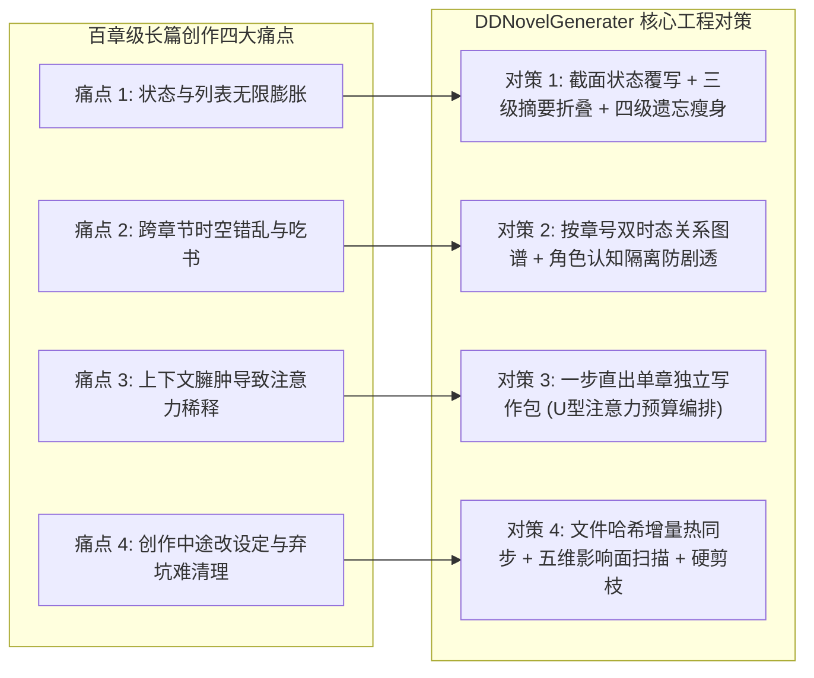

# 01. DDNovelGenerater 需求全景拆解说明书

> **关联文档**：
> - [02-system-architecture-design.md](file:///D:/work/AI/proj/DDNovelGenerater/docs/02-system-architecture-design.md)（系统架构、框架图、ER 图、类图与状态机）
> - [03-development-roadmap-and-dag.md](file:///D:/work/AI/proj/DDNovelGenerater/docs/03-development-roadmap-and-dag.md)（开发步骤、前后依赖与串并联流程图）

---

## 1. 核心业务背景与问题拆解

长篇小说创作在推进至 **300～1,000 章（100 万～300 万字）** 规模时，传统大模型对话流与常规 RAG 方案面临四大结构性矛盾。本工程将顶层目标拆解为对应的工程化解法：

---

## 2. 业务域功能需求拆解（WBS 结构图）

系统功能划分为 **7 大子系统、28 项原子功能点**：

```mermaid
flowchart TD
    Root["DDNovelGenerater 功能全景"]

    Root --> D1["1. 设定子系统 (01_settings)"]
    Root --> D2["2. 结构子系统 (02_structure)"]
    Root --> D3["3. 状态子系统 (03_state)"]
    Root --> D4["4. 创作子系统 (04_creation)"]
    Root --> D5["5. 派生索引与检索子系统 (.ddnovel)"]
    Root --> D6["6. 遗忘与瘦身生命周期子系统"]
    Root --> D7["7. 多宿主工程与接口子系统 (CLI/MCP/Skills)"]

    D1 --> D1_1["FR-01 作者优先自由 Markdown 书写"]
    D1 --> D1_2["FR-02 渐进式区块切片 (核心/专题/机密)"]
    D1 --> D1_3["FR-03 中途动态增删改设定"]
    D1 --> D1_4["FR-04 防吃书五维影响面扫描"]

    D2 --> D2_1["FR-05 全书总纲与分卷设计 (含卷折叠摘要)"]
    D2 --> D2_2["FR-06 单元/剧情弧设计 (含单元折叠摘要)"]
    D2 --> D2_3["FR-07 章节分场节拍蓝图 (Scenes/Beats)"]
    D2 --> D2_4["FR-08 规划期悬线伏笔三类雷达巡检"]

    D3 --> D3_1["FR-09 活跃实体当前截面状态覆写"]
    D3 --> D3_2["FR-10 角色认知边界维护 (已知/未知/误解)"]
    D3 --> D3_3["FR-11 通用内核 + 题材模板扩展槽校验"]
    D3 --> D3_4["FR-12 按章号生效的双时态关系边管理"]
    D3 --> D3_5["FR-13 悬线与事件伏笔全状态台账"]
    D3 --> D3_6["FR-14 逐章百字摘要与原子事实台账沉淀"]

    D4 --> D4_1["FR-15 文风指南与禁用词红线配置"]
    D4 --> D4_2["FR-16 一步直出可手改单章独立写作包"]
    D4 --> D4_3["FR-17 整章草稿一气呵成生成与通篇审改"]
    D4 --> D4_4["FR-18 草稿定稿入库与新设定反哺建档"]

    D5 --> D5_1["FR-19 文件哈希增量同步与零污染全量重建"]
    D5 --> D5_2["FR-20 Aho-Corasick 实体全名/外号自动嗅探"]
    D5 --> D5_3["FR-21 SQLite FTS5 中文专有名词精确检索"]
    D5 --> D5_4["FR-22 可选插拔向量语义混合检索插件"]

    D6 --> D6_1["FR-23 定稿后旧写作包与旧草稿 TTL 自动清理"]
    D6 --> D6_2["FR-24 退场实体与已填伏笔冷库休眠冻结"]
    D6 --> D6_3["FR-25 不想要的弃坑伏笔硬删除移除"]
    D6 --> D6_4["FR-26 孤儿废案与一次性龙套卡片物理剪枝"]
    D6 --> D6_5["FR-27 远期完结卷细碎事实蒸馏浓缩"]

    D7 --> D7_1["FR-28 一引擎多书解耦初始化与 CLI/MCP/Skills 双端暴露"]
```

---

## 3. 详细功能需求规格矩阵

### 3.1 【设定】模块需求（`01_settings/`）

| 编号 | 需求名称 | 优先级 | 输入 / 触发条件 | 核心处理逻辑与输出验收标准 |
| :--- | :--- | :---: | :--- | :--- |
| **FR-01** | 面向作者的自由格式兼容 | P0 | 任意新建/手改的 `.md` 设定文件 | 即使不写 YAML Frontmatter 或特定二级标题，解析器也能自动按文件路径推断 ID、名称与分类（世界观/地理/规则/组织/角色），绝不阻断作者灵感。 |
| **FR-02** | 渐进式三级切片隔离 | P0 | 含 `## [核心]`、`## [专题: X]`、`## [机密]` 的设定文件 | 默认仅将 `[核心]` 装入常规写作包；`[专题: X]` 仅在蓝图关联时按需装载；`[机密]` 默认物理隔离，仅在蓝图 `unlock_secrets` 点名时解锁。 |
| **FR-03** | 创作中途增删改热同步 | P0 | 任意章节阶段增删改 `01_settings/` 文件 | 增量对比文件 SHA-256，毫秒级更新 SQLite 词条与别名表；删除文件时自动级联清理索引残留。 |
| **FR-04** | 防吃书五维影响面扫描 | P0 | 准备修改或删除已有设定时调用 `setting impact` | 展开目标实体全部外号别名，跨【已定稿正文、历史事实台账、活跃状态、未完结伏笔、后续蓝图】扫描引用位置与上下文摘要，区分“安全直接删改”与“需圆前文”。 |

### 3.2 【结构】模块需求（`02_structure/`）

| 编号 | 需求名称 | 优先级 | 输入 / 触发条件 | 核心处理逻辑与输出验收标准 |
| :--- | :--- | :---: | :--- | :--- |
| **FR-05** | 总纲与分卷设计管理 | P0 | `master_outline.md`、`volumes/vol_XX.md` | 记录全书核心主线及各卷核心冲突；分卷完结后支持写入卷级折叠摘要，替代百章明细供后期宏观定位。 |
| **FR-06** | 单元（Arc）起承转合设计 | P0 | `arcs/vol_XX_arc_YY.md` | 承接分卷目标，规划 10～25 章规模的单元矛盾推进表与高潮节点，完结后沉淀单元摘要。 |
| **FR-07** | 章节蓝图与分场节拍定义 | P0 | `blueprints/vol_XX/ch_XXXX.md` | Frontmatter 声明章号、POV 视角、出场人物/地点/势力、指定处理的伏笔、解锁机密与本章禁止项；正文编写分场节拍（Scenes/Beats）引导整章节奏。 |
| **FR-08** | 规划期悬线伏笔雷达 | P0 | 编写单元/章节蓝图前调用 `radar` | 自动检测并高亮三类候选伏笔：① 预计回收窗口覆盖当前章；② 距上次推进超阈值章数（防断线遗忘）；③ 触发实体命中当前出场人物/地点。 |

### 3.3 【状态】模块需求（`03_state/`）

| 编号 | 需求名称 | 优先级 | 输入 / 触发条件 | 核心处理逻辑与输出验收标准 |
| :--- | :--- | :---: | :--- | :--- |
| **FR-09** | 当前截面状态直接覆写 | P0 | `world_state.yaml`、`active/*.yaml` | 只保存最新章结束时的截面状态（不追加历史流水账），单角色状态恒定在百字级；支持人类随时手改，配合 Git Tag 实现回滚。 |
| **FR-10** | 角色认知边界（防上帝视角） | P0 | 角色状态 `epistemic_bounds` 字段 | 显式区分 `knows`（已知）、`unaware_of`（尚不知晓，严禁顺嘴写破）、`misbelieves`（当前误判），在生成 POV 写作包时置顶警示。 |
| **FR-11** | 通用叙事内核 + 题材扩展槽 | P0 | `novel.yaml` 中配置的 `genre_profile` | 内核固定校验位置、身心状态、动机、认知边界；挂载 `cultivation_rpg`（境界/功法/法宝）或 `mystery_intrigue`（马甲/线索证据）时提供对应扩展校验。 |
| **FR-12** | 按章号生效的双时态关系边 | P0 | `relations.yaml` | 每条边含 `valid_from_ch` 与 `invalid_at_ch`；关系破裂或演变时关闭旧边、开启新边，按任意章号查询均不会发生前后期敌友关系错乱。 |
| **FR-13** | 悬线与事件伏笔台账 | P0 | `threads.yaml` | 维护伏笔状态（`planted / dormant / active / resolved`），分离 `public_clue`（表面线索）与 `truth_secret`（未揭晓底牌）。 |
| **FR-14** | 逐章摘要与原子事实沉淀 | P0 | `history/vol_XX_facts.jsonl` | 每章定稿提炼 100 字摘要 + 3～5 条高密度原子事实锚点（含涉及实体列表与书内时间），作为远距离历史召回的首选载体。 |

### 3.4 【创作】模块需求（`04_creation/`）

| 编号 | 需求名称 | 优先级 | 输入 / 触发条件 | 核心处理逻辑与输出验收标准 |
| :--- | :--- | :---: | :--- | :--- |
| **FR-15** | 文风红线与去 AI 腔约束 | P0 | `04_creation/style_guide.md` | 定义叙事腔调范本、人称视角规则与高频 AI 套话禁用词表，编译入写作包头部并在审校体检时自动校验。 |
| **FR-16** | 一步直出可编辑单章写作包 | P0 | 调用 `packet build <ch>` | 按 Token 预算与 U 型首尾注意力曲线一步生成 `packets/ch_XXXX_packet.md`，标注各区块估算 Token 数；未勾选的休眠伏笔与未解锁机密严禁入包；作者可直接手改增删。 |
| **FR-17** | 整章草稿一气呵成生成 | P0 | 执笔模型读取 `ch_XXXX_packet.md` | 执笔期完全隔离外部百章目录，仅依据单章写作包按节拍一气呵成输出完整草稿 `drafts/ch_XXXX_draft.md`，完成后供作者通篇审改。 |
| **FR-18** | 定稿入库与一致性体检 | P0 | 调用 `audit <ch>` 与 `chapter promote <ch>` | 检查死人/冷库角色未唤醒误出场、禁用词命中等冲突；通过后归档至 `manuscript/vol_XX/ch_XXXX.md`，并支持将草稿新涌现的临时配角/地点反哺建档。 |

### 3.5 派生索引、遗忘瘦身与多宿主协同需求

| 编号 | 需求名称 | 优先级 | 核心处理逻辑与输出验收标准 |
| :--- | :--- | :---: | :--- |
| **FR-19 ~ 22** | 混合派生检索引擎 | P0 (向量 P1) | `.ddnovel/index.sqlite` 集成 ID 直查、Aho-Corasick 别名嗅探、双时态 SQL 过滤、FTS5 中文检索；可选开启 Embedding 向量 RRF 混合重排；支持删改/回退后一键零污染重建。 |
| **FR-23** | 过程产物 TTL 自动清理 | P0 | 定稿入库后自动清理超出最近 N 章（默认 5 章）的历史 `packets/` 与 `drafts/`，杜绝过程文件堆积。 |
| **FR-24** | 退场实体与完结伏笔冷归档 | P0 | 死亡角色、已填伏笔、超阈值（默认 40 章）未出场且无绑定伏笔的路人移入 `archive/` 冷库，退出默认别名嗅探池与雷达池（软遗忘降噪）。 |
| **FR-25 ~ 26** | 弃坑伏笔与废案硬删除 | P0 | `thread drop` 彻底移除中途不想再填的伏笔；`setting prune` 扫描零引用废案设定与百章前一次性龙套卡片供物理删除瘦身。 |
| **FR-27** | 远期卷级历史蒸馏浓缩 | P1 | `history compact` 将已翻篇老卷的百章细碎过程事实浓缩合并为 15～20 条全卷核心里程碑事实，淘汰过期细节。 |
| **FR-28** | 一引擎多书与多宿主适配 | P0 | 引擎仓库与小说目录解耦；`ddnovel init` 支持一键生成 `opencode`（`opencode.json` + `.opencode/skills/`）、`dsh`（`.dsh/skills/` + `cordis.mcp.patch.yml`）及 `claude` 配置。 |

---

## 4. 非功能性需求与性能指标（NFR）

1. **百章/千章级响应延迟**：
   - 在 1,000 章（300 万字正文 + 5,000 条原子事实 + 500 个设定实体）规模下：
     - 单次增量索引同步（`index sync`）耗时 **< 200 ms**；
     - 全量零污染重建索引（`index rebuild`，不含远程 Embedding API 请求）耗时 **< 3 s**；
     - 单章写作包一步直出编译（`packet build`）耗时 **< 300 ms**。
2. **上下文注意力预算精度**：
   - 默认单章写作包总体积严格受控于配置上限（默认 `8,000 ~ 12,000 Tokens`），超出预算时按优先级自动裁剪远期低相关背景，绝不裁掉头部红线与尾部本章蓝图。
3. **零外部强依赖与跨版本兼容**：
   - 默认模式无需安装外部数据库服务、无需配置任何 API Key 即可 100% 离线运行；兼容 Windows / macOS / Linux 及 Python `3.11 ~ 3.14+`。
