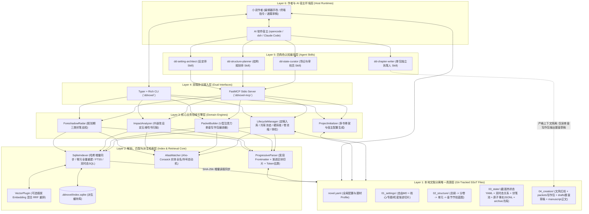
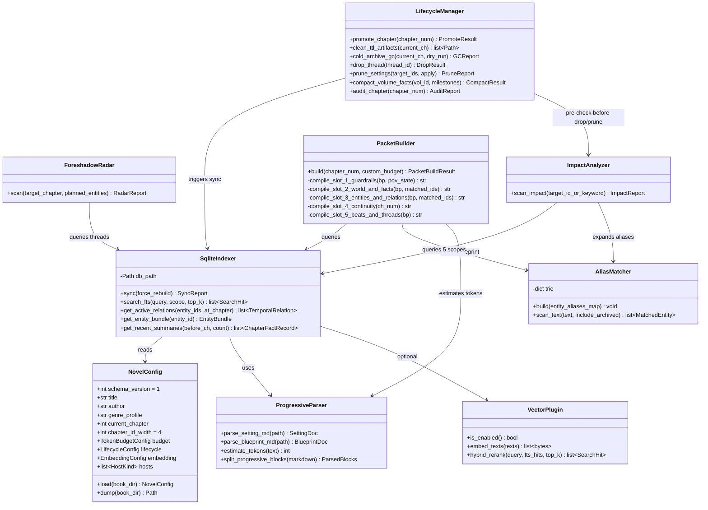
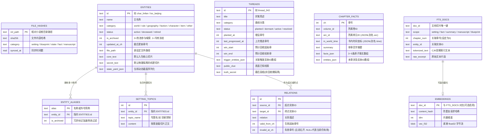
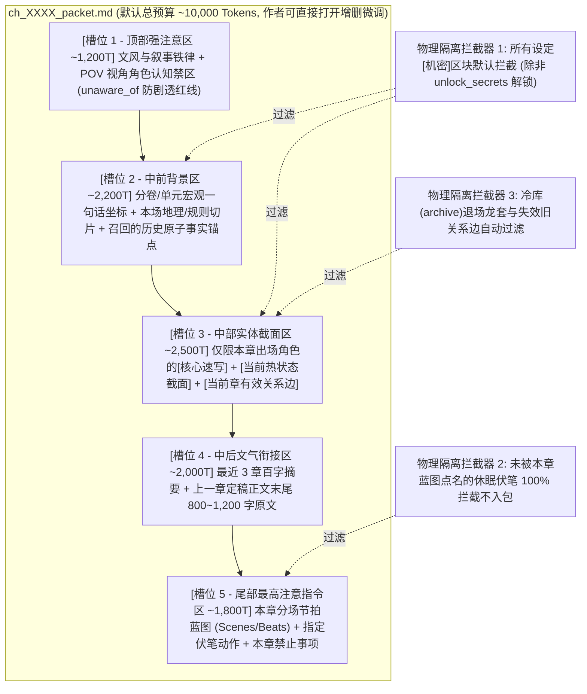
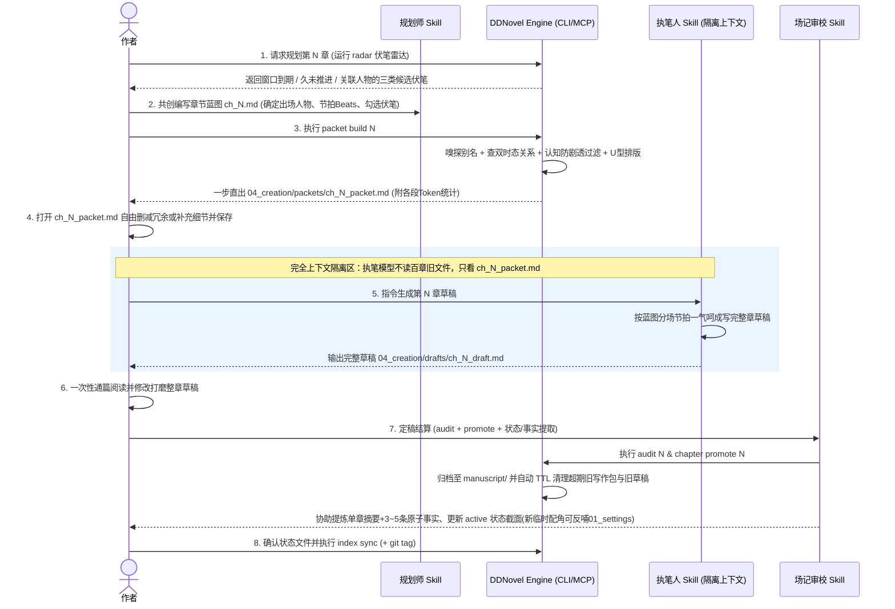
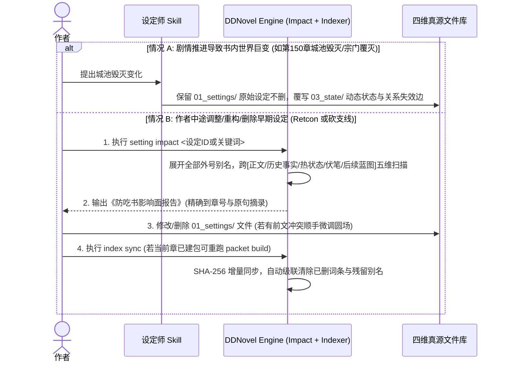
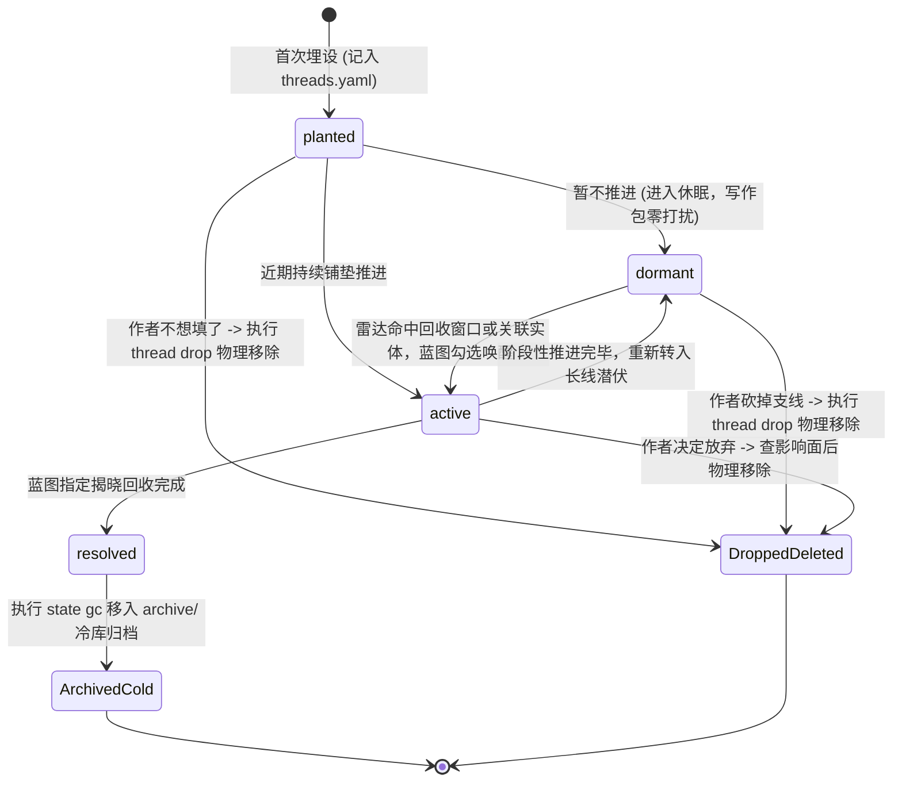
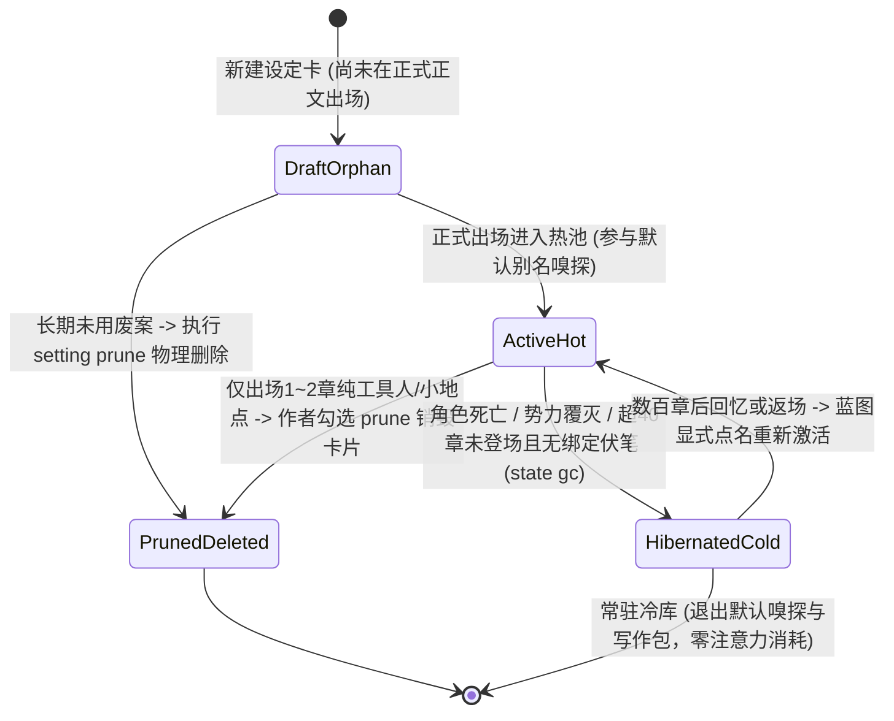

# 02. DDNovelGenerater 系统架构与详细设计方案

> **关联文档**：
> - [01-requirements-breakdown.md](file:///D:/work/AI/proj/DDNovelGenerater/docs/01-requirements-breakdown.md)（需求全景拆解说明书）
> - [03-development-roadmap-and-dag.md](file:///D:/work/AI/proj/DDNovelGenerater/docs/03-development-roadmap-and-dag.md)（开发步骤、前后依赖与串并联流程图）

---

## 1. 全景系统分层架构框架图

系统采用 **六层解耦架构**，自顶向下依次为：**人机与宿主交互层 -> 角色认知编排层（Skills）-> 双端协议接入层（CLI & MCP）-> 核心业务领域层 -> 解析与派生索引底座层 -> 文账分离唯一真源层（SSoT）**。

---

## 2. 核心模块结构与类依赖图（Class Diagram）

以下类图明确了 `src/ddnovel/` 各核心类的职责边界、核心方法与组合依赖关系，作为编码实现的直接接口契约：

---

## 3. 派生索引数据库设计（ER 图）

`.ddnovel/index.sqlite` 完全由本地文本真源派生，不存独占业务数据，表关系如下：

---

## 4. 单章独立写作包“U 型注意力预算槽位”框架图

大语言模型对长文本存在显著的 **首尾高注意、中部注意衰减（Lost in the Middle）** 现象。`PacketBuilder` 生成 `ch_XXXX_packet.md` 时严格按照以下五槽位结构排版与预算裁剪：

---

## 5. 核心业务流程时序图（Sequence Diagrams）

### 5.1 单章创作、通篇审稿、定稿与状态沉淀闭环

### 5.2 创作中途动态增删改设定与防吃书扫描时序图

---

## 6. 状态演进与四级遗忘状态机图（State Diagrams）

### 6.1 悬线与事件伏笔生命周期（含主动弃坑硬删除）

### 6.2 设定实体与历史记忆冷热瘦身生命周期

