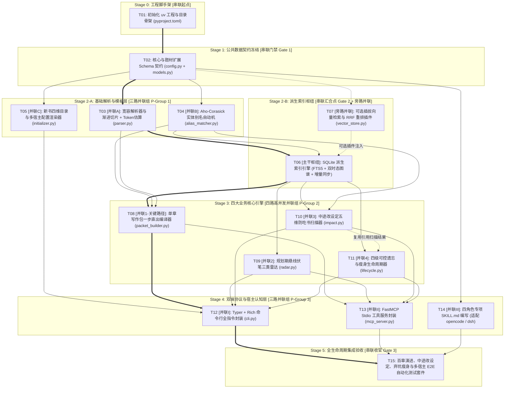
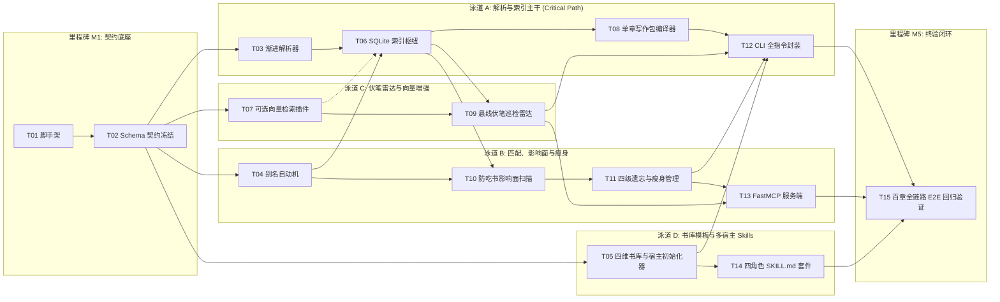

# 03. DDNovelGenerater 开发步骤与串并联依赖流程图

> **关联文档**：
> - [01-requirements-breakdown.md](file:///D:/work/AI/proj/DDNovelGenerater/docs/01-requirements-breakdown.md)（需求全景拆解说明书）
> - [02-system-architecture-design.md](file:///D:/work/AI/proj/DDNovelGenerater/docs/02-system-architecture-design.md)（系统架构与详细设计方案）

---

## 1. 全局开发依赖有向无环图（DAG：前后关系、关键路径与串并联结构）

整个研发工程拆解为 **6 个阶段（Stage 0 ~ Stage 5）、15 个原子开发任务（T01 ~ T15）**。
核心调度原则：**“契约先行串联锁定，实现模块多路并联，关键枢纽汇合联调”**。

- **实线粗箭头 (`==>`)**：代表**关键路径（Critical Path）**，决定整体最早完工时间。
- **普通实线箭头 (`-->`)**：代表**强前置依赖（Hard Dependency）**，上游接口或代码未就绪前下游不可合入。
- **虚线箭头 (`-.->`)**：代表**可选增强或软依赖（Soft / Optional Dependency）**，不阻塞主干推进。
- **同级横向并列子图（Parallel Group）**：代表**零耦合可完全并行开发**的任务组。

---

## 2. 串并联推进泳道图（Swimlane Execution Timeline）

若采用单人敏捷开发，可按阶段顺序逐组推进；若采用多开发者或多 Agent 协同（如 `/teamwork`），可沿以下 **4 条并行工作流泳道（Tracks）** 同步推进：

---

## 3. 15 项开发任务前后置依赖与验收规格详表

| 任务 ID | 任务名称 | 阶段 | 串/并联属性 | 前置依赖 (`Blocked By`) | 后置解锁 (`Unblocks`) | 核心交付文件 | 单元验证标准 |
| :--- | :--- | :---: | :---: | :---: | :---: | :--- | :--- |
| **T01** | 工程脚手架初始化 | S0 | **串联起点** | 无 | T02 | `pyproject.toml`, `src/ddnovel/__init__.py` | `uv sync` 成功，`uv run python -c "import ddnovel"` 正常退出 |
| **T02** | 核心与题材扩展 Schema | S1 | **串联门禁** | T01 | T03, T04, T05, T07, T14 | `core/schemas/config.py`, `core/schemas/models.py` | 覆盖 `general / cultivation_rpg / mystery_intrigue` 三种题材校验单测通过 |
| **T03** | 宽容解析与渐进切片器 | S2-A | **并联组 1-A** *(关键路径)* | T02 | T06, T08 | `core/parser.py` | 无 Frontmatter 自由 MD 解析、`[核心]/[专题]/[机密]` 切分与 Token 估算单测通过 |
| **T04** | Aho-Corasick 别名自动机 | S2-A | **并联组 1-B** | T02 | T06, T08, T10 | `core/alias_matcher.py` | 全名/外号/简称重叠匹配遵循最长优先、冷库实体自动跳过单测通过 |
| **T05** | 书库骨架与宿主配置器 | S2-A | **并联组 1-C** | T02 | T12 | `templates/initializer.py`, 样例文件集 | 在临时目录生成完整四维目录、`opencode.json` 与 `.dsh/` 配置结构正确 |
| **T06** | SQLite 派生索引枢纽 | S2-B | **串联汇合枢纽** *(关键路径)* | T03, T04 *(软依赖 T07)* | T08, T09, T10, T11 | `core/indexer.py` | FTS5 中文专有名词检索、双时态关系按章查询、删文件级联清理、`rebuild` 重建单测通过 |
| **T07** | 可选插拔向量检索插件 | S2-B | **旁路并联** | T02 | T06 (软注入) | `core/vector_store.py` | 关闭时零外部调用；Mock Embedding 下 RRF (BM25 + 余弦相似度) 重排准确 |
| **T08** | 单章写作包一步直出编译器 | S3 | **并联组 2-1** *(关键路径)* | T03, T04, T06 | T12, T13 | `core/packet_builder.py` | 输出 5 槽位 U 型结构 MD，`[机密]` 与未勾选伏笔 100% 物理隔离，Token 预算超限自动裁剪背景 |
| **T09** | 规划期悬线伏笔雷达 | S3 | **并联组 2-2** | T06 | T12, T13 | `core/radar.py` | 准确检出窗口到期、超期断线、出场实体关联三类伏笔，忽略冷库与已弃伏笔 |
| **T10** | 中途改设定影响面扫描器 | S3 | **并联组 2-3** | T04, T06 | T11, T12, T13 | `core/impact.py` | 修改或拟删设定时，准确返回正文、事实、活跃状态、伏笔、后续蓝图五处引用明细 |
| **T11** | 四级遗忘与瘦身生命周期器 | S3 | **并联组 2-4** | T06 *(复用 T10)* | T12, T13 | `core/lifecycle.py` | 验证 `promote` 自动清理旧包/旧稿、`gc` 移入冷库、`drop` 弃伏笔、`prune` 删孤儿设定、`compact` 浓缩卷事实、`audit` 体检 |
| **T12** | CLI 命令行全指令封装 | S4 | **并联组 3-I** *(关键路径)* | T05, T08, T09, T10, T11 | T15 | `cli.py` | `Typer CliRunner` 跑通全部 11 组子命令，终端表格与错误提示清晰 |
| **T13** | FastMCP 工具服务端封装 | S4 | **并联组 3-II** | T08, T09, T10, T11 | T15 | `mcp_server.py` | 全部 11 个 MCP Tool 注册成功、JSON Schema 合法、异步调用返回结构化文本 |
| **T14** | 多宿主四角色 Skills 编写 | S4 | **并联组 3-III** | T02 *(对齐 T12/T13 命名)* | T15 | `templates/skills/*/SKILL.md` | 设定师/规划师/执笔人/场记审校 4 套 `SKILL.md` 通过 `opencode` 与 `dsh` 元数据规范校验 |
| **T15** | 百章模拟全链路 E2E 验收 | S5 | **串联收官** | T12, T13, T14 | 正式交付 | `tests/test_e2e_hundred_chapters.py` | 模拟多卷多章连载 -> 中途改设定 -> 弃坑删支线 -> 冷归档 -> 新章建包，耗时与准确性全部达标 |

---

## 4. 关键分步实施说明（Step-by-Step Execution Guide）

### Step 1：打通契约底座（完成 `T01 -> T02`）
1. 创建 `pyproject.toml`，通过 `uv sync` 建立虚拟环境并锁定兼容 Python 3.11～3.14 的依赖。
2. 编写 `config.py` 与 `models.py` 并冻结字段名——**一旦此步完成，后续解析器、模板、Skills 全部拥有统一的输入输出类型，不再互相等待**。

### Step 2：并发构建解析、自动机与索引底座（完成 `T03 || T04 || T05 -> T06 (+ T07)`）
1. 并行实现宽容 Markdown 解析器（确保作者随意手写不报错，写 `## [机密]` 即隔离）与 Aho-Corasick 自动机。
2. 实现 `SqliteIndexer`：重点打磨 **CJK 字/双字流 + `trigram` 混合 FTS5 索引** 与 **`file_hashes` 增删改级联清理**，确保中途删改任何文件后 `index sync` 不留脏数据。

### Step 3：四路并发攻克核心业务引擎（完成 `T08 || T09 || T10 || T11`）
1. **`PacketBuilder` (`T08`)**：严格实现五槽位 U 型排版、POV `unaware_of` 置顶红线、机密与非回收伏笔物理屏蔽、Token 预算水位裁剪。
2. **`ForeshadowRadar` (`T09`)** & **`ImpactAnalyzer` (`T10`)**：分别解决“写前不忘坑”和“中途改设定不吃书”。
3. **`LifecycleManager` (`T11`)**：闭环解决“百章后不臃肿”——实现 TTL 过程清理、冷库休眠冻结、废案/弃坑物理硬删与老卷事实蒸馏。

### Step 4：双端协议封装与宿主 Skills 落地（完成 `T12 || T13 || T14`）
1. 将四大引擎统一挂载到 `ddnovel` CLI 与 `FastMCP` Server（业务逻辑 100% 留在 `core/`，CLI 与 MCP 仅做薄封装转发，杜绝双端行为不一致）。
2. 完成四套角色 `SKILL.md`，重点在 `dd-chapter-writer` 中锁死**“仅读 `ch_XXXX_packet.md` 一气呵成输出整章草稿”**的上下文隔离铁律。

### Step 5：百章高压模拟与交付验收（完成 `T15`）
1. 构造含 100+ 模拟章节事实、数十个退场/死亡角色、中途反转关系边、废弃伏笔与机密设定的测试书库。
2. 执行 `uv run pytest -v` 验证全量单测与集成测试，输出性能耗时与写作包隔离检验报告。
