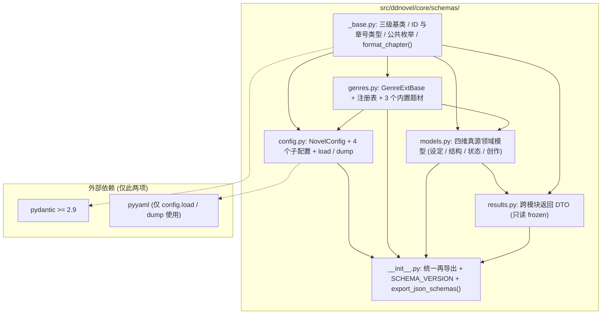
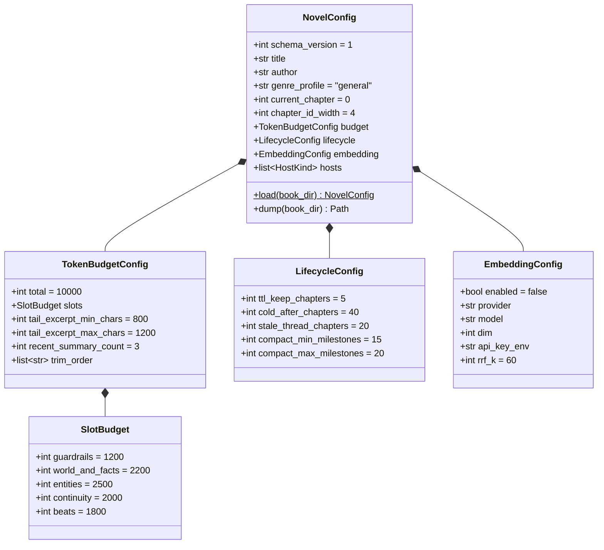
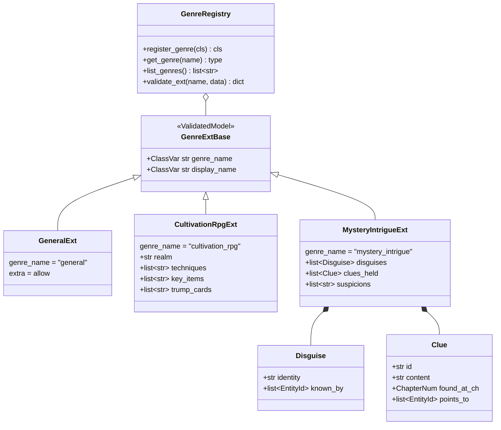
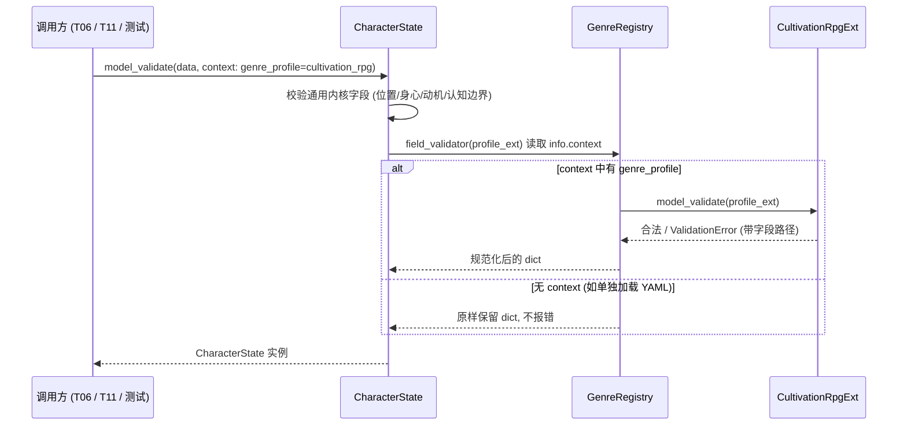
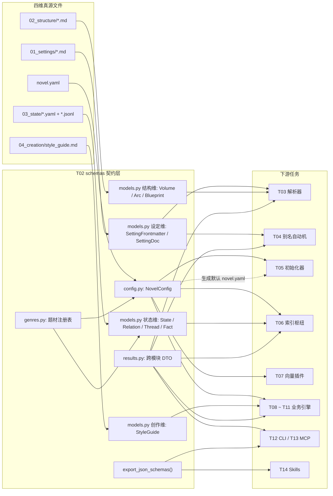
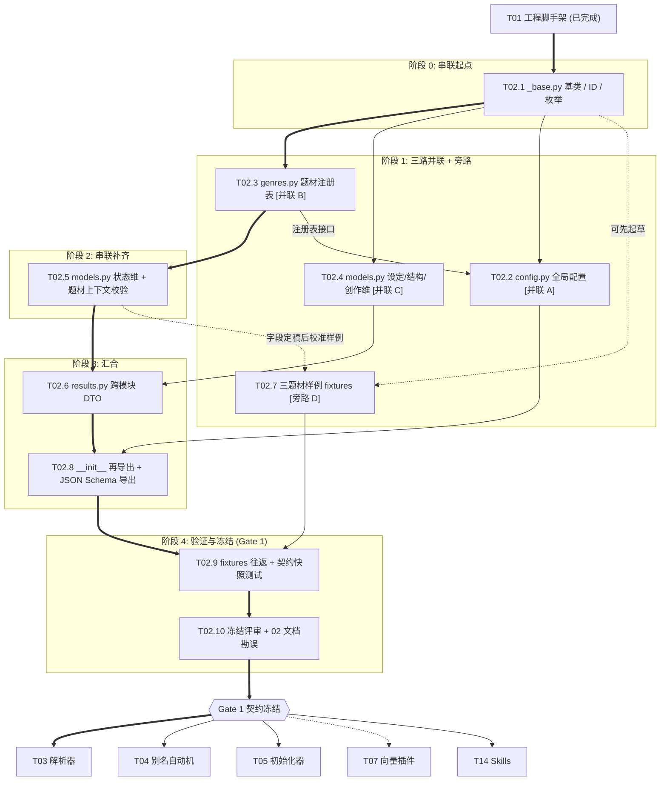
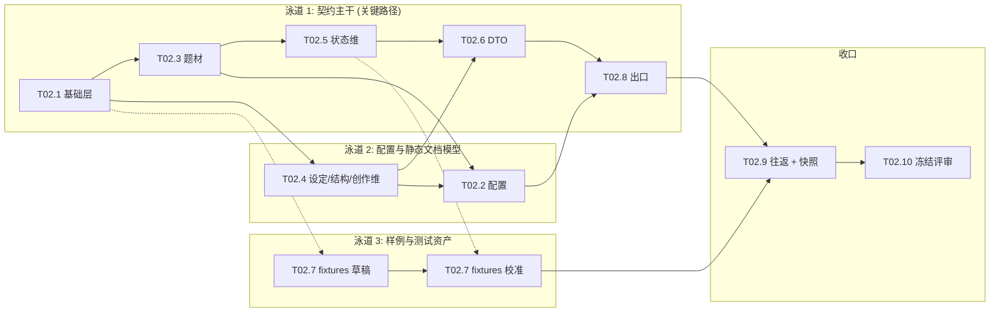

# T02. 核心与题材扩展 Schema 契约 —— 需求拆解、设计方案与开发流程

> **任务定位**：Stage 1 · **串联门禁 Gate 1**（前置 `T01` ✅ → 解锁 `T03 / T04 / T05 / T07 / T14`）
>
> **关联文档**：
> - [01-requirements-breakdown.md](file:///D:/work/AI/proj/DDNovelGenerater/docs/01-requirements-breakdown.md)（需求全景，FR-01 ~ FR-28）
> - [02-system-architecture-design.md](file:///D:/work/AI/proj/DDNovelGenerater/docs/02-system-architecture-design.md)（类图 / ER 图 / 写作包槽位）
> - [03-development-roadmap-and-dag.md](file:///D:/work/AI/proj/DDNovelGenerater/docs/03-development-roadmap-and-dag.md)（全局 DAG，T02 行）
> - [architecture-blueprint.md](file:///D:/work/AI/proj/DDNovelGenerater/docs/architecture-blueprint.md)（文件格式样例 §3.2 ~ §3.4）
>
> **当前代码基线**：**Gate 1 已完成冻结（`SCHEMA_VERSION = 1`）**，[schemas/\_\_init\_\_.py](file:///D:/work/AI/proj/DDNovelGenerater/src/ddnovel/core/schemas/__init__.py) 统一导出 85 个公开符号与 49 个具体模型 JSON Schema（快照锁定于 `tests/schemas/snapshots/schema_v1.json`）；运行环境 Python 3.11 + Pydantic 2.14。

---

## 0. 一句话目标

> 用 **Pydantic v2** 把“四维真源文件（`novel.yaml / 01_settings / 02_structure / 03_state / 04_creation`）的格式”与“各引擎之间的输入输出对象”**一次性写成代码并冻结**，让下游 `T03 ~ T14` 能**各自对着同一份类型并行开发、互不等待**。

T02 **只定义数据形状与单对象内校验**，不做文件扫描、Markdown 切片、SQLite、跨文件引用检查（这些分别属于 T03 / T06 / T11）。

---

## 1. 需求拆解

### 1.1 上游需求 → T02 契约职责映射

| 来源需求 | T02 需要承载的契约 | 归属文件 |
| :--- | :--- | :--- |
| FR-01 自由格式兼容 | 设定 Frontmatter **全部字段可选**、允许未知字段；ID/分类可由解析器推断后回填 | `models.py` · `SettingFrontmatter` |
| FR-02 渐进切片 | `SettingDoc` 显式区分 `core_text / topics / secret_text` 三类切片 | `models.py` · `SettingDoc` |
| FR-05 / FR-06 | 分卷、单元文档（章节区间 + 折叠摘要） | `models.py` · `VolumeDoc / ArcDoc` |
| FR-07 章节蓝图 | 章号、POV、出场实体、伏笔动作、`unlock_secrets`、禁止项、分场节拍 | `models.py` · `BlueprintDoc` |
| FR-09 截面状态 | 角色 / 势力 / 世界的**当前截面**模型（不含历史流水） | `models.py` · `CharacterState` 等 |
| FR-10 认知边界 | `knows / unaware_of / misbelieves` 三元组 | `models.py` · `EpistemicBounds` |
| FR-11 题材扩展槽 | 通用内核 + `general / cultivation_rpg / mystery_intrigue` 可插拔扩展 | `genres.py` |
| FR-12 双时态关系 | `valid_from_ch / invalid_at_ch` 及“按章是否有效”判定 | `models.py` · `TemporalRelation` |
| FR-13 伏笔台账 | 四态状态机枚举、回收窗口、`public_clue / truth_secret` 分离 | `models.py` · `Thread` |
| FR-14 原子事实 | 与 JSONL 样例字段**完全兼容**（`ch / arc / time / summary / facts / entities`） | `models.py` · `ChapterFactRecord` |
| FR-15 文风红线 | 文风指南结构化部分（禁用词表、视角规则） | `models.py` · `StyleGuide` |
| FR-16 / NFR-2 预算 | 总预算 + 五槽位分配 + 溢出裁剪策略 | `config.py` · `TokenBudgetConfig` |
| FR-22 向量插件 | 默认关闭、无 API Key 也能加载的 Embedding 配置 | `config.py` · `EmbeddingConfig` |
| FR-23 / FR-24 / FR-27 | TTL 保留章数、冷库阈值、断线阈值、卷浓缩条数 | `config.py` · `LifecycleConfig` |
| FR-28 多宿主 | 宿主枚举 `opencode / dsh / claude` | `config.py` · `HostKind` |
| 类图 §2 返回类型 | `SyncReport / SearchHit / RadarReport / ImpactReport / PacketBuildResult / AuditReport ...` 等跨模块 DTO | `results.py` |
| NFR-3 零依赖 | Schema 层仅依赖 `pydantic + pyyaml`，不引入 IO 重依赖 | 全部 |

### 1.2 T02 工作分解结构（WBS）

```mermaid
flowchart TD
    Root["T02 Schema 契约冻结"]

    Root --> W1["W1 公共基础层 _base.py"]
    Root --> W2["W2 全局配置 config.py"]
    Root --> W3["W3 题材扩展 genres.py"]
    Root --> W4["W4 真源领域模型 models.py"]
    Root --> W5["W5 跨模块结果 DTO results.py"]
    Root --> W6["W6 契约出口与冻结"]

    W1 --> W1a["三级基类 Lenient / Validated / Strict"]
    W1 --> W1b["ID 与章号约束类型"]
    W1 --> W1c["公共枚举 + 前缀分类映射"]

    W2 --> W2a["NovelConfig 主配置 + load / dump"]
    W2 --> W2b["TokenBudget / Lifecycle / Embedding / Host 子配置"]

    W3 --> W3a["GenreExtBase + 注册表 + register_genre"]
    W3 --> W3b["general / cultivation_rpg / mystery_intrigue"]

    W4 --> W4a["设定维 SettingFrontmatter / SettingDoc"]
    W4 --> W4b["结构维 Volume / Arc / Blueprint / Beat"]
    W4 --> W4c["状态维 Character / Faction / World State"]
    W4 --> W4d["状态维 TemporalRelation / Thread / ChapterFact"]
    W4 --> W4e["创作维 StyleGuide"]

    W5 --> W5a["解析与匹配 ParsedBlocks / MatchedEntity"]
    W5 --> W5b["索引与检索 SyncReport / SearchHit / EntityBundle"]
    W5 --> W5c["业务报告 Radar / Impact / Packet / Lifecycle / Audit"]

    W6 --> W6a["__init__ 统一再导出 + SCHEMA_VERSION"]
    W6 --> W6b["JSON Schema 导出 (供 T13 / T14)"]
    W6 --> W6c["三题材样例 fixtures + 单测 + 契约快照"]
```



### 1.3 边界澄清（做 / 不做）

| ✅ T02 负责 | ❌ T02 不负责（归属） |
| :--- | :--- |
| 字段名、类型、默认值、枚举取值 | Markdown 区块切分、Frontmatter 宽容解析（T03） |
| 单对象内部一致性校验（窗口起止、关系有效区间、预算求和） | 跨文件引用校验：蓝图引用的 ID 是否存在（T06 / T11 audit） |
| `novel.yaml` 的读取与写回（唯一的 IO） | 目录扫描、文件哈希、SQLite 表结构（T06） |
| 题材扩展槽的注册与校验 | 题材样例书库模板文件（T05） |
| 跨模块 DTO 的形状 | DTO 的计算逻辑（T03 ~ T11） |
| JSON Schema 导出函数 | MCP Tool 注册（T13）、SKILL.md 文案（T14） |

---

## 2. 设计方案

### 2.1 设计原则

1. **文件即契约**：每个真源文件都有一个顶层模型与之 1:1 对应，`model_validate(yaml.safe_load(...))` 即可加载，`model_dump(by_alias=True, exclude_none=True)` 可写回且保持作者可读。
2. **宽严分级**：作者手写的内容宽容，引擎生成/消费的内容严格（见 §2.3）。
3. **内核固定 + 扩展可插**：通用叙事内核字段永不随题材变化；题材差异只出现在 `profile_ext` 槽内。
4. **契约先行、只增不改**：冻结后仅允许**新增可选字段**；任何改名/删字段/改类型都需提升 `SCHEMA_VERSION` 并提供迁移说明。
5. **零 IO 纯数据**：除 `NovelConfig.load / dump` 外，Schema 层不访问文件系统，便于下游单测直接构造对象。

### 2.2 模块结构图



> [!NOTE]
> 路线图中 T02 的交付物写作 `config.py + models.py`。为避免 `models.py` 膨胀到上千行，并让 `T03~T11` 的返回类型也能提前冻结，本方案额外拆出 `_base.py / genres.py / results.py`，并由 `__init__.py` 统一再导出——下游一律 `from ddnovel.core.schemas import Xxx`，不感知内部拆分。

**依赖规则**：`_base` ← `genres` ← `models` ← `results`，单向无环；`config` 只依赖 `_base` 与 `genres`（校验 `genre_profile` 是否已注册）。

### 2.3 宽严三级基类

| 级别 | 基类 | `model_config` | 适用对象 | 理由 |
| :---: | :--- | :--- | :--- | :--- |
| **L0 宽容** | `LenientModel` | `extra="allow"`、全字段可选、`str_strip_whitespace=True` | 设定 / 蓝图 / 分卷 / 单元 Frontmatter | FR-01：作者随手写不报错，缺失项由 T03 按路径推断回填 |
| **L1 校验** | `ValidatedModel` | `extra="allow"`（保留到 `model_extra` 以便原样写回）、核心字段强类型 | `03_state/*` 全部 YAML / JSONL、`StyleGuide` | 结构化状态需可靠，但允许作者附加备注字段；未知字段由 T11 audit 报 warning |
| **L2 严格** | `StrictModel` | `extra="forbid"`、`validate_assignment=True` | `novel.yaml` 配置 | 配置拼写错误必须立刻报错，不能静默失效 |
| **L2 只读** | `FrozenDTO` | `extra="forbid"`、`frozen=True` | `results.py` 全部 DTO | 引擎间传递对象不可被篡改，可哈希、可缓存 |

### 2.4 公共类型与命名约定（`_base.py`）

| 类型 | 定义 | 示例 |
| :--- | :--- | :--- |
| `ChapterNum` | `Annotated[int, Field(ge=1)]` | `142` |
| `EntityId` | 正则 `^[a-z][a-z0-9]*_[a-z0-9_]+$` | `char_linfan` / `loc_zhuixinggu` |
| `VolumeId` | `^vol_\d{2,}$` | `vol_01` |
| `ArcId` | `^vol_\d{2,}_arc_\d{2,}$` | `vol_01_arc_03` |
| `ThreadId` | `^thread_[a-z0-9_]+$` | `thread_042` |
| `ChapterWindow` | `(start, end)` 元组，校验 `start <= end` | `[140, 155]` |

**ID 前缀 → 设定分类推荐映射**（`ID_PREFIX_CATEGORY`，供 T03 推断 / T11 audit 提示，不强制）：

| 前缀 | `char_` | `loc_` | `fac_` | `world_` | `rule_` | `item_` |
| :--- | :--- | :--- | :--- | :--- | :--- | :--- |
| 分类 | character | geography | faction | world | rule | item |

**公共枚举**：

| 枚举 | 取值 |
| :--- | :--- |
| `SettingCategory` | `world / rule / geography / faction / character / item / other` |
| `EntityStatus` | `active / deceased / retired`（势力覆灭归 `retired`） |
| `ThreadStatus` | `planted / dormant / active / resolved`（弃坑 = 物理删除，故无 `dropped`） |
| `ThreadAction` | `plant / progress / resolve` |
| `FtsScope` | `setting / fact / summary / manuscript / blueprint` |
| `HostKind` | `opencode / dsh / claude` |
| `IssueLevel` | `info / warning / error` |

工具函数：`format_chapter(n, width=4) -> "ch_0042"`，统一全工程文件名格式。

### 2.5 全局配置模型（`config.py`）



**关键校验规则**：

| 规则 | 失败行为 |
| :--- | :--- |
| `genre_profile` 必须在题材注册表中 | `ValidationError`，提示可选值列表 |
| `sum(slots) <= total` | 报错并给出差额 |
| `trim_order` 只能包含 `world_and_facts / entities / continuity`（**头部 guardrails 与尾部 beats 永不可裁**，对齐 NFR-2） | 报错 |
| `tail_excerpt_min_chars <= tail_excerpt_max_chars`、`compact_min <= compact_max` | 报错 |
| `embedding.enabled=True` 时 `provider / model / dim` 必填；**API Key 只存环境变量名，绝不落盘明文** | 报错 |
| `NovelConfig.load` 文件不存在 | 抛 `FileNotFoundError`（由 T12 转为友好提示） |

### 2.6 题材扩展机制（`genres.py`）



**校验链路**——状态模型在不知道题材时保持宽容，知道题材时严格校验：



> [!TIP]
> 第三方题材只需新建一个 `GenreExtBase` 子类并加 `@register_genre` 装饰器即可接入，无需改动内核模型——这是 FR-11“题材模板扩展槽”的落地方式。

### 2.7 四维真源领域模型（`models.py`）

```mermaid
classDiagram
    direction LR

    class SettingFrontmatter {
        <<LenientModel>>
        +EntityId? id
        +str? name
        +list~str~ aliases
        +SettingCategory? category
        +EntityStatus status = active
        +list~str~ tags
    }
    class SettingDoc {
        <<ValidatedModel>>
        +EntityId id
        +str name
        +SettingCategory category
        +list~str~ aliases
        +EntityStatus status
        +str file_path
        +str core_text
        +dict~str,str~ topics
        +str? secret_text
        +all_names() list~str~
    }

    class VolumeDoc {
        <<LenientModel>>
        +VolumeId id
        +str title
        +ChapterWindow? chapter_range
        +str core_conflict
        +str? folded_summary
    }
    class ArcDoc {
        <<LenientModel>>
        +ArcId id
        +VolumeId volume_id
        +ChapterWindow? chapter_range
        +str? folded_summary
    }
    class BlueprintDoc {
        <<LenientModel>>
        +ChapterNum chapter
        +VolumeId? volume_id
        +ArcId? arc_id
        +str? title
        +EntityId? pov
        +BlueprintCast cast
        +list~ThreadRef~ threads
        +list~EntityId~ unlock_secrets
        +list~TopicRef~ topics
        +list~str~ forbidden
        +list~Beat~ beats
        +str body
        +all_entity_ids() list~EntityId~
    }
    class BlueprintCast {
        +list~EntityId~ characters
        +list~EntityId~ locations
        +list~EntityId~ factions
        +list~EntityId~ items
    }
    class ThreadRef {
        +ThreadId thread_id
        +ThreadAction action
    }
    class TopicRef {
        +EntityId entity_id
        +str topic
    }
    class Beat {
        +int index
        +str title
        +str content
    }

    class EpistemicBounds {
        +list~str~ knows
        +list~str~ unaware_of
        +list~str~ misbelieves
    }
    class CharacterState {
        <<ValidatedModel>>
        +ChapterNum updated_at_ch
        +EntityId? location
        +str physical_mental
        +list~str~ current_goals
        +EpistemicBounds epistemic_bounds
        +dict profile_ext
    }
    class FactionState {
        <<ValidatedModel>>
        +ChapterNum updated_at_ch
        +EntityStatus status
        +EntityId? leader
        +list~EntityId~ territory
        +list~str~ current_goals
        +dict profile_ext
    }
    class WorldState {
        <<ValidatedModel>>
        +int current_chapter
        +str in_world_time
        +str macro_situation
    }
    class TemporalRelation {
        <<ValidatedModel>>
        +EntityId source
        +EntityId target
        +str relation
        +ChapterNum valid_from_ch
        +ChapterNum? invalid_at_ch
        +is_valid_at(ch) bool
    }
    class Thread {
        <<ValidatedModel>>
        +ThreadId id
        +str title
        +str? category
        +ThreadStatus status
        +ChapterNum planted_at
        +ChapterNum last_progressed_at
        +ChapterWindow? expected_window
        +list~EntityId~ trigger_entities
        +str public_clue
        +str? truth_secret
    }
    class ChapterFactRecord {
        <<ValidatedModel>>
        +ChapterNum ch
        +VolumeId? volume_id
        +ArcId? arc_id
        +str? in_world_time
        +str summary
        +list~str~ facts
        +list~EntityId~ entities
    }
    class StyleGuide {
        <<ValidatedModel>>
        +str tone
        +list~str~ pov_rules
        +list~str~ banned_words
        +str raw_markdown
    }

    SettingFrontmatter ..> SettingDoc : T03 推断补全后生成
    BlueprintDoc *-- BlueprintCast
    BlueprintDoc *-- ThreadRef
    BlueprintDoc *-- TopicRef
    BlueprintDoc *-- Beat
    CharacterState *-- EpistemicBounds
```



**文件容器模型**（与真源文件 1:1）：

| 真源文件 | 顶层容器模型 | 形态 |
| :--- | :--- | :--- |
| `novel.yaml` | `NovelConfig` | 对象 |
| `01_settings/**/*.md` Frontmatter | `SettingFrontmatter` → T03 产出 `SettingDoc` | 对象 |
| `02_structure/volumes/vol_XX.md` | `VolumeDoc` | 对象 |
| `02_structure/arcs/vol_XX_arc_YY.md` | `ArcDoc` | 对象 |
| `02_structure/blueprints/vol_XX/ch_XXXX.md` | `BlueprintDoc` | 对象 |
| `03_state/world_state.yaml` | `WorldState` | 对象 |
| `03_state/active/characters.yaml` | `CharacterStateFile = RootModel[dict[EntityId, CharacterState]]` | 映射 |
| `03_state/active/factions.yaml` | `FactionStateFile = RootModel[dict[EntityId, FactionState]]` | 映射 |
| `03_state/relations.yaml` | `RelationsFile { relations: list[TemporalRelation] }` | 列表 |
| `03_state/threads.yaml` | `ThreadsFile { threads: list[Thread] }` | 列表 |
| `03_state/history/vol_XX_facts.jsonl` | 每行一个 `ChapterFactRecord` | JSONL |
| `03_state/archive/*` | 复用上述同名容器（冷库与热池同构） | — |
| `04_creation/style_guide.md` | `StyleGuide` | 对象 |

**单对象内校验规则**：

| 模型 | 规则 | 级别 |
| :--- | :--- | :---: |
| `TemporalRelation` | `invalid_at_ch is None or invalid_at_ch > valid_from_ch`；`source != target` | error |
| `TemporalRelation.is_valid_at(ch)` | `valid_from_ch <= ch < invalid_at_ch`（失效章当章即不再有效，对齐蓝图“第 120 章反目，121 章起敌对”） | — |
| `Thread` | `last_progressed_at >= planted_at`；`expected_window.start <= end`；`status=resolved` 时允许 `truth_secret` 为空 | error |
| `ChapterFactRecord` | `facts` 长度 1~8 为硬约束（3~5 为推荐，越界由 T11 audit 给 warning）；`summary` 非空 | error |
| `BlueprintDoc` | `threads` 内同一 `thread_id` 不可重复；`unlock_secrets` 去重；`pov` 若给出应出现在 `cast.characters`（**自动补入而非报错**，保持宽容） | 自动修正 |
| `SettingDoc` | `aliases` 自动去重并剔除与 `name` 相同项；`all_names()` 返回名称 + 外号供 T04 建自动机 | 自动修正 |
| `EpistemicBounds` | 三个列表各自去重 | 自动修正 |

> [!IMPORTANT]
> **跨文件引用一致性**（如蓝图中的 `thread_id` 是否存在于 `threads.yaml`、`pov` 是否有设定卡）**不在 Schema 层校验**，因为单个模型拿不到全书上下文。它们由 T06 索引后、T11 `audit` 统一检查，避免 T02 引入 IO 依赖。

### 2.8 跨模块结果 DTO（`results.py`）

这些对象是类图中各引擎方法的返回类型。**提前冻结它们，是 T03 ~ T11 能够并行开发、T12 / T13 能提前写渲染逻辑的关键。**

| DTO | 生产者 | 消费者 | 核心字段 |
| :--- | :--- | :--- | :--- |
| `ParsedBlocks` | T03 | T06 / T08 | `core: str`, `topics: dict[str,str]`, `secret: str?`, `token_estimates: dict[str,int]` |
| `MatchedEntity` | T04 | T06 / T08 / T10 | `entity_id`, `alias`, `start`, `end`, `is_archived` |
| `SyncReport` | T06 | T11 / T12 / T13 | `added / updated / deleted: list[str]`, `elapsed_ms`, `rebuilt: bool` |
| `SearchHit` | T06 / T07 | T08 / T10 / T12 / T13 | `doc_id`, `scope: FtsScope`, `chapter_num`, `entity_id?`, `excerpt`, `score` |
| `EntityBundle` | T06 | T08 / T12 / T13 | `setting: SettingDoc`, `state: CharacterState \| FactionState \| None`, `relations: list[TemporalRelation]`, `is_archived` |
| `RadarHit` / `RadarReport` | T09 | T12 / T13 | `thread: Thread`, `reasons: list["window" \| "stale" \| "entity"]`, `detail` |
| `ImpactHit` / `ImpactReport` | T10 | T11 / T12 / T13 | `scope: "manuscript" \| "fact" \| "state" \| "thread" \| "blueprint"`, `location`, `chapter_num?`, `excerpt`；报告含 `is_safe_to_change` |
| `SlotReport` / `PacketBuildResult` | T08 | T12 / T13 | 每槽 `name / budget / used / trimmed`；结果含 `packet_path`, `total_tokens`, `blocked_secrets`, `blocked_threads` |
| `PromoteResult` / `GCReport` / `DropResult` / `PruneReport` / `CompactResult` | T11 | T12 / T13 | 各自的移动/删除路径清单与 `dry_run` 标志 |
| `AuditIssue` / `AuditReport` | T11 | T12 / T13 / T14 | `level: IssueLevel`, `code`, `message`, `location`；报告含 `passed: bool` |

> [!NOTE]
> DTO 只冻结**字段形状**。若下游开发中发现缺字段，按“只增不改”原则追加可选字段并同步更新快照测试即可，不必阻塞其它并行任务。

### 2.9 真源文件 → 模型 → 下游消费 数据流框架图



### 2.10 下游消费矩阵

| 契约 \ 下游 | T03 | T04 | T05 | T06 | T07 | T08 | T09 | T10 | T11 | T12 | T13 | T14 |
| :--- | :-: | :-: | :-: | :-: | :-: | :-: | :-: | :-: | :-: | :-: | :-: | :-: |
| `NovelConfig` 及子配置 | | | ● | ● | ● | ● | ● | | ● | ● | ● | ○ |
| 题材注册表 | | | ● | ● | | | | | ● | ● | | ● |
| `SettingFrontmatter / SettingDoc` | ● | ● | ○ | ● | | ● | | ● | ● | | | ○ |
| `Volume / Arc / BlueprintDoc` | ● | | ○ | ● | | ● | ● | ● | ● | | | ● |
| `CharacterState / FactionState / WorldState` | | | ○ | ● | | ● | | ● | ● | | | ● |
| `TemporalRelation / Thread / ChapterFactRecord` | | | ○ | ● | | ● | ● | ● | ● | | | ● |
| `StyleGuide` | ● | | ○ | | | ● | | | ● | | | |
| `results.py` DTO | ● | ● | | ● | ● | ● | ● | ● | ● | ● | ● | |
| JSON Schema 导出 | | | | | | | | | | ○ | ● | ● |

● 强依赖（编码直接 import）　○ 弱依赖（样例文件/文档需与字段对齐）

### 2.11 契约出口与冻结机制

```python
# src/ddnovel/core/schemas/__init__.py （契约出口示意）
SCHEMA_VERSION = 1

from ._base import ChapterNum, EntityId, VolumeId, ArcId, ThreadId, format_chapter, ...
from .config import NovelConfig, TokenBudgetConfig, SlotBudget, LifecycleConfig, EmbeddingConfig
from .genres import GenreExtBase, register_genre, get_genre, list_genres
from .models import SettingDoc, BlueprintDoc, CharacterState, TemporalRelation, Thread, ChapterFactRecord, ...
from .results import SyncReport, SearchHit, PacketBuildResult, AuditReport, ...

def export_json_schemas() -> dict[str, dict]:
    """导出全部公开模型的 JSON Schema，供 T13 MCP 参数声明与 T14 SKILL.md 字段说明引用。"""
```

**冻结门禁（Gate 1 通过条件）**：

1. `tests/schemas/test_contract_snapshot.py` 将 `export_json_schemas()` 输出与仓库内 `tests/schemas/snapshots/schema_v1.json` 对比；任何字段变更都会使测试失败，**强制变更走评审**。
2. 三套题材样例 fixtures 全部通过加载→校验→写回→再加载的**往返一致性**测试。
3. `ruff check` 零告警；`uv run pytest` 全绿。

---

## 3. 开发步骤

### 3.1 子任务清单

| 子任务 | 内容 | 前置依赖 | 串/并联属性 | 交付文件 | 验证标准 | 估时 |
| :--- | :--- | :---: | :---: | :--- | :--- | :---: |
| **T02.1** | 公共基础层：三级基类、ID/章号类型、枚举、`format_chapter` | T01 ✅ | **串联起点** | `_base.py` | 正则正/反例、基类 extra 行为单测 | 0.5d |
| **T02.2** | 全局配置：`NovelConfig` + 4 子配置 + 校验 + `load/dump` | T02.1、T02.3（仅注册表接口） | **并联 A** | `config.py` | 预算求和、trim_order、embedding 必填、往返读写单测 | 0.5d |
| **T02.3** | 题材扩展：基类、注册表、3 个内置题材 | T02.1 | **并联 B**（关键路径） | `genres.py` | 注册/查询/重复注册报错、三题材正反例 | 0.5d |
| **T02.4** | 设定维 + 结构维 + 创作维模型 | T02.1 | **并联 C** | `models.py`（上半） | 宽容加载空 Frontmatter、蓝图自动修正规则 | 0.75d |
| **T02.5** | 状态维模型 + 文件容器 + 题材上下文校验 | T02.1、T02.3 | **串联于 B 之后**（关键路径） | `models.py`（下半） | 双时态 `is_valid_at` 边界、伏笔窗口、JSONL 别名字段兼容 | 0.75d |
| **T02.6** | 跨模块结果 DTO | T02.4、T02.5 | **汇合点**（关键路径） | `results.py` | frozen 不可变、序列化往返 | 0.5d |
| **T02.7** | 三题材样例 fixtures | T02.1（可先写草稿） | **旁路并联 D** | `tests/fixtures/books/{general,cultivation_rpg,mystery_intrigue}/` | 文件覆盖全部真源类型 | 0.5d |
| **T02.8** | 契约出口：再导出、`SCHEMA_VERSION`、`export_json_schemas()` | T02.2、T02.6 | **汇合点**（关键路径） | `__init__.py` | 所有公开名可导入；导出结果为合法 JSON Schema | 0.25d |
| **T02.9** | 集成测试：fixtures 往返 + 契约快照 | T02.7、T02.8 | **串联** | `tests/schemas/test_fixtures_roundtrip.py`、`test_contract_snapshot.py`、`snapshots/schema_v1.json` | 往返一致、快照生成 | 0.5d |
| **T02.10** | 冻结评审：对照 §2.10 消费矩阵逐项确认，更新 02 文档类图/ER 差异 | T02.9 | **串联终点 / Gate 1** | 本文档 + `02-system-architecture-design.md` 勘误 | `ruff` + `pytest` 全绿，评审通过 | 0.25d |

> 单元测试与对应实现**同步编写**（每个子任务自带 `tests/schemas/test_<module>.py`），不单列任务。

### 3.2 开发流程图（前后关系 · 依赖关系 · 串并联）

图例：`==>` 关键路径　`-->` 强依赖　`-.->` 软依赖 / 可提前启动



**关键路径**：`T02.1 → T02.3 → T02.5 → T02.6 → T02.8 → T02.9 → T02.10`，合计约 **3.25 人日**；并联分支 A / C / D 均有 ≥ 0.25d 浮动时间。

### 3.3 泳道视图（单人 / 多 Agent 两种推进方式）



- **单人推进**：按 `T02.1 → T02.3 → T02.4 → T02.5 → T02.2 → T02.6 → T02.7 → T02.8 → T02.9 → T02.10` 顺序即可，约 5 人日。
- **2~3 路并行**：按泳道分配，约 3.5 人日完成（受关键路径约束）。

### 3.4 每步编码要点

**Step 1 · T02.1 基础层**
- 用 `typing.Annotated + pydantic.StringConstraints / Field` 定义约束类型，所有正则集中在一处。
- `LenientModel / ValidatedModel / StrictModel / FrozenDTO` 四个基类只设置 `model_config`，不写业务方法。

**Step 2 · T02.3 题材注册表**
- 注册表为模块级 `dict[str, type[GenreExtBase]]`；重复注册同名题材抛 `ValueError`。
- `GeneralExt` 使用 `extra="allow"`，保证无题材书也能随意写扩展字段。

**Step 3 · T02.4 / T02.5 领域模型**
- 自动修正类规则统一用 `model_validator(mode="after")`，报错类规则用 `field_validator`。
- `ChapterFactRecord` 通过 `Field(alias="arc") / Field(alias="time")` + `populate_by_name=True` 兼容蓝图中的 JSONL 样例，写回时 `by_alias=True` 保持原格式。
- `profile_ext` 的题材校验通过 `ValidationInfo.context` 获取 `genre_profile`，无上下文时不校验。

**Step 4 · T02.2 配置**
- `load(book_dir)` 读取 `book_dir / "novel.yaml"`，`yaml.safe_load` 后 `model_validate`；`dump` 使用 `sort_keys=False, allow_unicode=True` 保证中文可读、字段顺序稳定。

**Step 5 · T02.6 / T02.8 / T02.9 收口**
- DTO 一律 `FrozenDTO`；路径字段统一用 `str`（POSIX 风格相对路径），避免 Windows / Linux 序列化差异。
- `export_json_schemas()` 用 `TypeAdapter(...).json_schema(mode="serialization")`；快照文件首次由测试脚本生成并提交。

### 3.5 测试矩阵

| 测试文件 | 覆盖内容 | 关键用例 |
| :--- | :--- | :--- |
| `test_base.py` | ID / 章号 / 窗口类型 | `Char_LinFan` 拒绝；`ch=0` 拒绝；`[155, 140]` 拒绝 |
| `test_config.py` | 配置校验与读写 | 槽位总和超预算；`trim_order` 含 `beats` 报错；未知字段 `budgte` 报错；默认配置往返 |
| `test_genres.py` | 题材注册与扩展校验 | 三题材正例；`cultivation_rpg` 中 `realm` 传 list 报错；自定义题材注册 |
| `test_models_static.py` | 设定 / 结构 / 文风 | 空 Frontmatter 可加载；`pov` 自动补入 `cast`；重复 `thread_id` 报错 |
| `test_models_state.py` | 状态 / 关系 / 伏笔 / 事实 | `is_valid_at(119)=True / (120)=False`；JSONL 样例原样加载与写回；无 context 时 `profile_ext` 不校验 |
| `test_results.py` | DTO | 修改 frozen 字段抛错；序列化往返 |
| `test_fixtures_roundtrip.py` | 三题材样例书 | 全部真源文件 加载 → dump → 再加载 相等 |
| `test_contract_snapshot.py` | 契约冻结 | JSON Schema 与快照一致 |

---

## 4. 验收标准（Definition of Done）

- [x] `src/ddnovel/core/schemas/` 下 `_base / config / genres / models / results / __init__` 六个文件完成，单向依赖无循环导入。
- [x] `general / cultivation_rpg / mystery_intrigue` 三套题材 fixtures 校验与往返测试通过（对应路线图 T02 验收标准）。
- [x] 与 [architecture-blueprint.md §3.2](file:///D:/work/AI/proj/DDNovelGenerater/docs/architecture-blueprint.md) 中 `characters.yaml` 与 JSONL 样例**逐字可加载**。
- [x] `export_json_schemas()` 输出合法，契约快照已提交。
- [x] `uv run ruff check` 零告警，`uv run pytest` 全绿（含 T01 冒烟测试）。
- [x] [02-system-architecture-design.md](file:///D:/work/AI/proj/DDNovelGenerater/docs/02-system-architecture-design.md) 类图 / ER 图与最终字段名一致（如有差异已勘误）。

---

## 5. 风险与决策记录

| # | 风险 / 决策点 | 处理方案 |
| :-: | :--- | :--- |
| R1 | 契约冻结后下游发现缺字段，导致返工 | 只增不改 + 快照评审；DTO 新增可选字段不视为破坏性变更 |
| R2 | 宽容策略过度，导致作者笔误被静默吞掉 | 宽容层保留 `model_extra`，由 T11 `audit` 输出“未知字段”warning；配置层严格拒绝 |
| R3 | `profile_ext` 题材校验依赖上下文，调用方忘传 | T06 索引入口统一传入 `NovelConfig.genre_profile`；T11 audit 二次全量校验 |
| R4 | 02 文档 ER 中 `CHAPTER_FACTS.arc_id` 与蓝图 JSONL 中 `arc` 命名不一致 | 模型字段用 `arc_id`、别名 `arc`，两种写法都可读入；写回保持作者原格式 |
| R5 | 势力覆灭是否需要独立状态 `destroyed` | v1 统一用 `retired`，避免扩大枚举；如需细分在 v1.x 以新增枚举值方式追加 |
| D1 | 交付物从 2 个文件拆为 6 个文件 | 由 `__init__` 统一再导出，对下游透明；理由见 §2.2 |
| D2 | `results.py` DTO 纳入 T02 | 使 T03 ~ T11 能真正并行，T12 / T13 可提前开发渲染层 |
