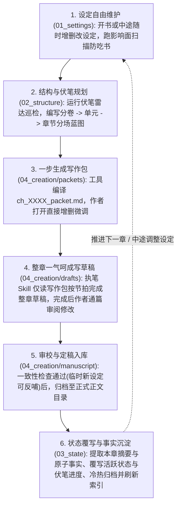

# DDNovelGenerater 架构设计蓝图（Architecture Blueprint）

> 本文档基于架构访谈共识沉淀，定义了面向百章/百万字规模长篇小说的 **Agent-Native 创作引擎套件** 完整架构规范。
>
> **配套工程规格文档索引**：
> - [01-requirements-breakdown.md](file:///D:/work/AI/proj/DDNovelGenerater/docs/01-requirements-breakdown.md) —— 需求全景拆解与 WBS 规格矩阵
> - [02-system-architecture-design.md](file:///D:/work/AI/proj/DDNovelGenerater/docs/02-system-architecture-design.md) —— 系统分层框架图、类图、ER 图、时序图与状态机
> - [03-development-roadmap-and-dag.md](file:///D:/work/AI/proj/DDNovelGenerater/docs/03-development-roadmap-and-dag.md) —— 15 步开发计划、前后依赖与串并联 DAG 流程图

---

## 1. 核心定位与设计哲学

`DDNovelGenerater` 是一个**与具体小说书库解耦、一引擎驱动多本书**的创作工程底座，依托 `dsh`、`opencode`、Claude Code 等 AI 软件宿主运行，对外提供 **Python CLI (`ddnovel`) + MCP Server (`FastMCP`) + 多角色专项 Skills**。

### 四大架构公理（解决百章规模痛点）
1. **文账分离、文件真源（SSoT）**：所有核心数据以人类可读可手改的本地文本文件（`Markdown + YAML Frontmatter` 与 `YAML / JSONL`）为唯一真源；版本回溯与废稿分支完全依托 **Git Commit/Tag**，保证 100% 所见即所得。
2. **索引派生、零污重建**：检索加速层采用单文件 `.ddnovel/index.sqlite`（内置双时态关系表 + 别名自动机字典 + `FTS5` 中文分词全文检索 + 可选插拔 `sqlite-vec` 向量插件）。索引库完全由真源文件派生，推翻重写任意章节后可毫秒级全量/增量重建，绝无“前世幽灵记忆”残留。
3. **冷热分离、金字塔折叠（防文件爆炸）**：动态状态只覆写**当前最新截面**（不追加流水账），久未登场实体与已完结悬线归入 `archive/` 冷库；历史记忆通过 **“单章百字摘要 + 3~5 条原子事实锚点 -> 单元摘要 -> 卷级大事记”** 三级压缩沉淀。
4. **单章写作包完全隔离（保模型注意力）**：规划与检索在动笔前完成，一步直出可人工增删裁剪的独立 Markdown 写作包（`ch_XXXX_packet.md`）。执笔阶段模型**仅读取该写作包**一气呵成完成整章草稿，写完后交由作者通篇审阅修改，彻底隔绝百章历史噪音与上帝视角剧透。

---

## 2. 双仓库解耦结构

### 2.1 引擎仓库结构（`DDNovelGenerater` 本工程）

```text
DDNovelGenerater/
├── pyproject.toml                 # uv 管理的 Python 包配置 (FastMCP, Pydantic, PyYAML, jieba 等)
├── docs/                          # 引擎架构与规范文档
├── src/ddnovel/
│   ├── cli.py                     # 命令行入口 (`ddnovel init / index / radar / packet / archive ...`)
│   ├── mcp_server.py              # FastMCP Server 暴露工具集
│   ├── core/
│   │   ├── schemas/               # Pydantic 核心模型 + Genre Profile 题材扩展模型
│   │   ├── parser.py              # 作者友好型渐进式 Markdown/Frontmatter 解析器
│   │   ├── indexer.py             # SQLite (FTS5 + 双时态图谱 + 可选 sqlite-vec) 同步与重建器
│   │   ├── alias_matcher.py       # 实体名称/外号/简称嗅探自动机
│   │   ├── radar.py               # 规划期悬线伏笔巡检与告警器
│   │   ├── impact.py              # 设定中途增删改“防吃书”前文影响面扫描器
│   │   └── packet_builder.py      # 一步直出单章写作包编译器（预算控制 + U型注意力排版 + 认知防剧透）
│   └── templates/
│       ├── book_skeleton/         # 新书初始化四维目录与样例模板
│       └── host_configs/          # 适配 opencode / dsh / claude 的 MCP 与 Skills 安装模板
└── skills/                        # 多角色精细共创 Skills 定义
    ├── dd-setting-architect/      # 设定师：协助打磨/中途增删改世界观设定、冲突影响评估与渐进式切片
    ├── dd-structure-planner/      # 结构规划师：协助设计分卷/单元/章节蓝图与伏笔雷达调度
    ├── dd-chapter-writer/         # 执笔人：严格基于单章写作包一气呵成完成整章草稿
    └── dd-state-curator/          # 场记与审校员：穿帮检查、草稿新设定反哺入库、提炼原子事实、更新状态面板
```

### 2.2 小说工程目录结构（通过 `ddnovel init <book_dir>` 生成）

```text
my-novel-book/
├── novel.yaml                     # 本书全局配置 (书名、题材扩展 Profile、默认写作包 Token 预算、可选 Embedding 配置)
│
├── 01_settings/                   # 【设定】面向作者优先的自由 Markdown + Frontmatter
│   ├── world/                     # 世界观、底层法则、力量/规则体系
│   ├── geography/                 # 大陆 -> 区域 -> 城池/地形设定
│   ├── factions/                  # 组织/宗门/势力设定
│   └── characters/                # 角色静态档案 (底色性格、语言腔调范例、身世背景)
│
├── 02_structure/                  # 【结构】从大到小三级叙事蓝图树
│   ├── master_outline.md          # 全书总纲与核心立意
│   ├── volumes/                   # 分卷设计 (如 `vol_01.md`，完结后维护卷级折叠大事记)
│   ├── arcs/                      # 单元设计 (如 `vol_01_arc_02.md`，含单元起承转合与单元折叠摘要)
│   └── blueprints/                # 章节蓝图 (如 `vol_01/ch_0042.md`，定义场景节拍 Scenes/Beats、出场实体、指定伏笔)
│
├── 03_state/                      # 【状态】纯 YAML / JSONL，直接覆写当前截面 + 冷热分池
│   ├── world_state.yaml           # 当前世界日历/时间线、天下大势截面
│   ├── active/                    # 【热池】当前活跃角色与组织的动态面板（位置、身心、动机、认知边界、题材扩展槽）
│   │   ├── characters.yaml        # 或按需拆分为单角色精简 YAML，始终控制在百字级当前截面
│   │   └── factions.yaml
│   ├── relations.yaml             # 双时态实体关系边 (valid_from_ch, invalid_at_ch)
│   ├── threads.yaml               # 悬线与事件伏笔活跃台账 (planted / dormant / active)
│   ├── history/                   # 逐章提炼的历史记忆台账（按卷分文件防膨胀）
│   │   └── vol_01_facts.jsonl     # 每章一条：百字摘要 + 3~5 条高密度原子事实锚点
│   └── archive/                   # 【冷库】久未出场龙套状态、已失效旧关系、已回收(resolved)伏笔归档
│
├── 04_creation/                   # 【创作】写作包、整章草稿与正式正文
│   ├── style_guide.md             # 本书文风指南、叙事视角红线、禁用词/去 AI 腔规则
│   ├── packets/                   # 一步直出、可人工直接编辑裁剪的单章独立写作包 (`ch_0042_packet.md`)
│   ├── drafts/                    # 基于写作包一气呵成生成的整章草稿，供作者通篇审改 (`ch_0042_draft.md`)
│   └── manuscript/                # 定稿归档正文（按卷分目录：`vol_01/ch_0001.md`）
│
└── .ddnovel/                      # 【派生缓存】（加入 .gitignore，随时可从四大目录毫秒级重建）
    └── index.sqlite               # FTS5 全文表 + 实体别名表 + 时序关系表 + 事实锚点表 (+ 可选向量表)
```

---

## 3. 核心数据规范与关键机制设计

### 3.1 【设定】作者优先、渐进式切片与中途增删改（`01_settings/`）
* **自由书写兼容**：作者新建或修改任何设定 `.md` 时无需受限于死板模板；若全文未标记特殊区块且篇幅适中，入包时默认载入正文。
* **按需渐进分块**：当某个设定（如主角、大宗门、大地图）越写越长或包含后期反转机密时，作者可使用轻量约定标题拆分：
  * `## [核心]`（或默认首段）：出场时默认入包（建议 150～300 字：核心人设、口癖外貌）。
  * `## [专题: 剑冢禁制]`：仅当章节蓝图提及该子标签或嗅探命中时按需切片入包，不拖累无关章节。
  * `## [机密]`（Secret）：**默认物理隔离，严禁进入常规写作包**！仅当章节蓝图显式声明揭晓该机密时才解锁载入，从根源杜绝大模型顺嘴剧透。
* **创作中途动态增删改保障（防吃书三板斧）**：
  1. **随时增删改 + 索引热同步**：创作到任意章节均可随时新增、修改或删除 `01_settings/` 设定文件（也支持在写完某章草稿后，将草稿中临时涌现的新地点/新配角/新道具反哺提炼建档）；引擎基于文件哈希增量刷新 `index.sqlite`，删除文件自动清理残留词条与别名，并可随时重编当前章写作包。
  2. **防吃书“影响面扫描”（Impact Scan）**：准备修改或删除某个已有设定时，调用 `ddnovel setting impact <id_or_keyword>`，利用别名自动机 + 关联表 + FTS5 一键列出该设定在**过往已定稿正文、历史事实台账、当前活跃状态、未完结伏笔及后续蓝图**中的全部引用处与上下文摘要，辅助作者秒判是“无历史包袱直接改删”还是“需顺手圆一下前文”。
  3. **区分“作者改设定（Retcon）”与“剧情内世界演进（In-World Evolution）”**：
     * 若属作者推翻/微调早期设定（如修改功法限制、删掉冗余支线势力），直接增删改 `01_settings/` 并跑影响面检查；
     * 若属剧情推进导致的书内巨变（如第 150 章某座城池沦陷毁灭、某宗门覆灭重组、天地法则异变），**保留 `01_settings/` 中的原始基础设定不删**，将演变结果覆写进 `03_state/`（世界/组织状态截面与双时态关系网），确保回溯前文与推进新章两不冲突。

### 3.2 【状态】通用叙事内核 + 题材 Profile 扩展（`03_state/`）
每个活跃角色的状态截面严格只保留**“此时此刻”**：
```yaml
# 03_state/active/characters.yaml 示例片段
char_linfan:
  updated_at_ch: 141
  location: loc_beijing_gucheng
  physical_mental: "左肩剑伤未愈，因刚得知师门变故而表面冷静实则高度戒备"
  current_goals:
    - "混入北境拍卖会查清古镜来历"
  epistemic_bounds:                 # 【防穿帮核心：角色认知边界】
    knows:
      - "赵乾死前曾提及血魂印"
    unaware_of:
      - "同行旅伴苏瑶实为北境妖庭圣女（严禁在林凡视角描写中看破）"
    misbelieves:
      - "以为师尊玄尘仍在闭死关"
  profile_ext:                      # 可选题材扩展槽（如 cultivation_rpg 模板校验）
    realm: "筑基后期"
    key_items: ["残缺青铜古镜", "三枚破障丹"]
    trump_cards: ["惊雷剑诀（每日限用一剑）"]
```

* **双时态关系网（`relations.yaml`）**：
  记录 `(source, target, relation_desc, valid_from_ch, invalid_at_ch)`。当第 120 章两人反目时，将旧边 `invalid_at_ch` 设为 `120`（随后可归档冷库），新增 `valid_from_ch: 121` 的敌对边。查询任意章状态均精确无歧义。
* **历史原子事实台账（`history/vol_XX_facts.jsonl`）**：
  每章定稿提炼一条轻量记录，彻底替代“翻找几百万字旧正文”：
  ```json
  {"ch": 87, "arc": "vol_01_arc_03", "time": "天历三年秋", "summary": "林凡在坠星谷设伏反杀赵乾，夺得古镜但身中血魂印。", "facts": ["赵乾于第87章在坠星谷死亡", "林凡获得残缺青铜古镜", "赵家老祖通过血魂印感知到凶手在南域"], "entities": ["char_linfan", "char_zhaoqian", "loc_zhuixinggu", "item_gujing"]}
  ```

### 3.3 悬线与事件伏笔“双轨制”（`threads.yaml`）
1. **规划期雷达巡检（`ddnovel radar`）**：
   写单元设计或章节蓝图时，引擎扫描 `threads.yaml` 输出巡检简报，高亮三类伏笔供作者手动挑选：
   * **窗口到期**：`expected_window`（如 `[140, 155]`）覆盖当前章号的伏笔；
   * **断线告警**：距离 `last_progressed_ch` 超过设定章数未提及的活跃悬线；
   * **实体联动**：`trigger_entities` 命中当前单元出场人物/地点的休眠伏笔。
2. **写作期严格按蓝图装载**：
   生成单章写作包时，**绝不把未勾选的几十条休眠伏笔塞入写作包**；仅装载本章蓝图明确指定要 `plant（新埋） / progress（推进线索） / resolve（回收揭晓）` 的条目，并在非揭晓期自动隐藏 `truth_secret` 真相字段。

### 3.4 一步直出可编辑“单章写作包”（`04_creation/packets/ch_XXXX_packet.md`）
运行 `ddnovel packet build 142` 后，直接生成一份自包含、标注了各段约算 Token 数的纯 Markdown 文件，按大模型 **U 型注意力曲线（首尾最强）** 编排：
1. **[头部强约束区]** 本书文风精要 (`style_guide.md`) + 本章叙事视角（POV）与防穿帮认知红线（`unaware_of` 汇总）。
2. **[宏观与环境背景区]** 所在卷/单元核心目标一句话坐标 + 本章登场地理地形/规则设定切片 + 关联召回的历史原子事实锚点。
3. **[登场实体热状态区]** 本章出场角色的【核心速写】+【当前状态截面】+ 角色彼此间的当前有效关系边。
4. **[前文丝滑衔接区]** 最近 2～3 章百字摘要 + **上一章末尾最后 800～1200 字定稿正文**（对齐文气、时空与动作）。
5. **[尾部最高注意力指令区]** **本章章节蓝图（分场节拍 Scene 1 / Scene 2 / Scene 3 细纲）** + 本章指定伏笔动作 + 本章禁止事项（Negative Constraints）。

> 作者可直接打开 `ch_0142_packet.md` 自由删减冗余背景、微调措辞，保存后即可作为执笔模型的**唯一上下文输入**。

### 3.5 遗忘与全生命周期瘦身机制（防噪音与数据膨胀）
写到数百至上千章时，**真正的危机不是硬盘装不下文本（300 万字纯文本仅 ~9MB），而是“列表噪音爆炸、过期词条误触发与弃坑伏笔死缠烂打”**。因此设计**四级可控遗忘与物理瘦身**机制（绝不做黑盒随机遗忘，全部可控可查）：
1. **过程产物 TTL 自动清理（`clean`）**：
   * 单章定稿入库（`promote`）后，历史章节的 `packets/`（写作包）和 `drafts/`（初稿）默认只保留最近 N 章（如最近 5 章），更早的过程文件自动物理删除，消灭最大的冗余文件源。
2. **自然退场“软遗忘 / 休眠冻结”（`state gc`）**：
   * 针对已死亡角色、已覆灭势力、已回收（`resolved`）伏笔、或连续超过阈值（如 40 章）未登场且无未了伏笔绑定的路人配角/过渡小地图：一键移入 `archive/` 冷库，并**从默认别名自动嗅探词表与雷达池中摘除**。平时规划和编译写作包时完全隐身（注意力零干扰），仅在显式搜索全量历史时可查。
3. **弃坑与废案“硬剪枝物理删除”（`prune / drop`）**：
   * **主动弃坑伏笔（`thread drop <id>`）**：中途不想继续写的支线或伏笔，调用 `drop`（自动附带一次轻量前文提及提示）即可从 `threads.yaml` 彻底移除（或仅留一行单行废案备忘），伏笔雷达永不再告警。
   * **废案与一次性工具人瘦身（`setting prune`）**：自动扫描两类冗余设定供作者勾选物理删除：① 从未在正式正文中落地的“废案孤儿设定”；② 百章前仅出场 1～2 次再无后续的纯工具人/路边酒馆卡片（无需保留独立文件，当章一行历史事实足矣）。
4. **远期历史“卷级蒸馏遗忘”（`history compact <vol>`）**：
   * 当早期某卷（如第 1 卷 1～100 章）已翻篇数百章，其中大量过程性琐碎事实（如“第 12 章买了一把铁剑、第 18 章住某客栈”）已彻底过期；可执行卷级蒸馏，将百章的几百条细碎事实浓缩合并为 15～20 条**全卷核心里程碑事实**，直接淘汰过期流水细节。

---

## 4. 全手动精细共创标准工作流（Step-by-Step）



---

## 5. CLI 与 MCP 工具矩阵设计

为了同时满足**作者在终端手动执行**与**在 `dsh` / `opencode` 中让 AI 助手辅助调用**，同一套核心逻辑双端暴露：

| 功能域 | CLI 命令 (`ddnovel ...`) | MCP Tool 名称 | 作用说明 |
| :--- | :--- | :--- | :--- |
| **工程管理** | `init <dir> [--host opencode\|dsh]` | — (仅 CLI) | 初始化小说四维目录骨架、题材模板及宿主 MCP/Skills 配置 |
| **设定维护** | `setting upsert / list / show` | `novel_upsert_setting` / `novel_list_settings` | **新建/修改/查阅设定**（角色、地理地形、世界规则、组织等），支持自由手改文件或工具化创建/更新并自动热同步索引 |
| **设定影响面** | `setting impact <id_or_query>` | `novel_setting_impact` | **中途改/删设定防吃书**：扫描已定稿正文、事实台账、活跃状态、伏笔与后续蓝图中的所有引用处 |
| **结构与蓝图** | `structure volume / arc / blueprint` | `novel_upsert_volume` / `novel_upsert_arc` / `novel_upsert_blueprint` | **设计分卷、单元、章节蓝图**（生成标准结构骨架、校验出场实体与伏笔 ID 合法性，同样支持直接手改 `.md`） |
| **伏笔雷达** | `radar [--chapter N]` | `novel_foreshadow_radar` | 扫描输出到期窗口、断线超期、出场实体关联的候选悬线与伏笔报告 |
| **写作包输出** | `packet build <ch>` | `novel_build_packet` / `novel_read_packet` | **一步输出单章写作包** `04_creation/packets/ch_XXXX_packet.md`（汇报各区块 Token 占比，供作者裁剪与执笔模型隔离读取） |
| **草稿创作** | `draft save <ch>` / `draft show <ch>` | `novel_save_draft` | **写作与保存整章草稿**（配合 `dd-chapter-writer` Skill 严格仅基于本章写作包一气呵成生成 `drafts/ch_XXXX_draft.md` 供作者通篇审改） |
| **定稿与结算** | `chapter promote <ch>` / `state update` | `novel_promote_chapter` / `novel_record_chapter_outcome` | **正式定稿入库**（归入 `manuscript/` 并清理超期旧包/旧稿），沉淀本章摘要+原子事实并覆写最新角色/组织/伏笔状态 |
| **索引与检索** | `index sync / rebuild` / `search` / `state inspect` | `novel_sync_index` / `novel_search` / `novel_inspect_entity` | 增量或零污染全量重建 `index.sqlite`；按关键词(FTS5)、ID、章号检索设定、实体当前截面状态与历史事实 |
| **遗忘与瘦身** | `state gc` / `setting prune` / `thread drop` / `history compact` | `novel_cold_archive` / `novel_prune_unused` / `novel_drop_thread` | **软冻结与硬删除瘦身**：退场实体/已填伏笔移入冷库、物理删除废案/一次性龙套、主动弃坑移除伏笔、浓缩远期老卷细碎事实 |
| **一致性体检** | `audit <ch>` | `novel_audit_consistency` | 静态规则体检（检查蓝图引用 ID 是否存在/已被删、死人或冷库角色未唤醒出场、禁止词命中等） |
